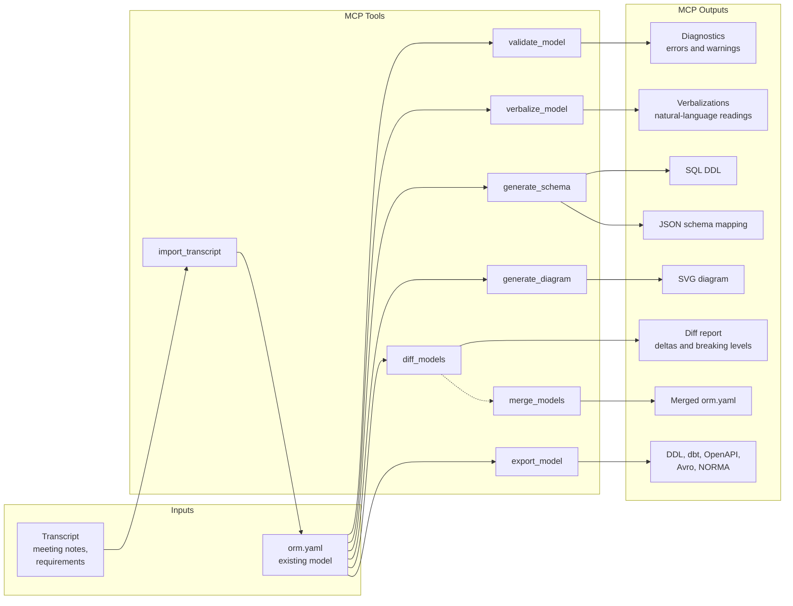

# Barwise MCP Server

MCP (Model Context Protocol) server that exposes barwise ORM 2 modeling
capabilities as tools, resources, and prompts. Any AI tool that speaks
MCP gets access to validation, verbalization, schema generation,
diffing, diagram generation, transcript import, and model merging.

---

## How It Works

The diagram below shows how barwise tools fit together. Inputs enter
from the left, flow through an ORM model in the center, and produce
output artifacts on the right.



**Typical flow**: start with a transcript or existing `.orm.yaml`,
validate it, verbalize to confirm domain semantics, then generate
artifacts. `export_model` produces every registered export format (DDL,
dbt, OpenAPI, Avro, NORMA); `generate_schema` and `generate_diagram`
produce the relational mapping and the SVG diagram. For a walkthrough of
the whole workflow, see
[getting-started/mcp.md](getting-started/mcp.md).

---

## Setup

### Option 1: VS Code Extension (recommended)

Install the **Barwise ORM Modeler** extension. Fifteen of the server's
tools are registered with VS Code's Language Model Tool API and appear
automatically in Copilot Chat -- no configuration needed. The gym tools and
`analyze_repository` are not among them; repository analysis is the
**ORM: Analyze Repository** palette command instead.

You can reference any tool directly in Copilot Chat using `#`:

- `#barwiseValidate` -- validate a model
- `#barwiseVerbalize` -- verbalize fact types
- `#barwiseSchema` -- generate DDL or JSON schema
- `#barwiseDiff` -- compare two models
- `#barwiseDiagram` -- generate an SVG diagram
- `#barwiseImport` -- extract a model from a transcript
- `#barwiseMerge` -- merge two models (writes the base file)
- `#barwiseExport` -- export to any registered format
- `#barwiseDescribe` -- summarize entities and rules
- `#barwiseQuery` -- run a structural query
- `#barwiseImportModel` -- import DDL, SQL, OpenAPI, NORMA, dbt or code
- `#barwiseReview` -- LLM review of a model
- `#barwiseLineage` -- check exported artifacts for staleness
- `#barwiseImpact` -- list artifacts built from an element
- `#barwiseSplit` -- split a model into a multi-domain project

The extension also registers an MCP stdio server for external tools
that discover MCP servers through VS Code.

To disable both mechanisms, set `barwise.enableMcpServer` to `false` in
VS Code settings.

**LLM provider for transcript import**: The VS Code extension uses your
Copilot subscription by default -- no API key needed. To use Anthropic
instead, set `barwise.llmProvider` to `"anthropic"` and run
**Barwise: Set Anthropic API Key**, which stores the key in the OS keychain.

### Option 2: Standalone (Claude Code, Claude Desktop, Cursor, etc.)

For AI tools outside VS Code, download `barwise-mcp-<version>.cjs` from the
[releases page](https://github.com/semantic-praxis/barwise/releases) and run
it with Node. It is a single file with no dependencies. (From a clone,
`npm run build` produces `packages/mcp/dist/index.js`, which works the same
way.) The barwise packages are not published to npm, so `npx @barwise/mcp`
does not work.

Every configuration below uses `node` and the file's absolute path; replace
`/path/to/barwise-mcp.cjs` with yours.

**LLM provider for transcript import**: The standalone server requires
an LLM provider configured via environment variables:

- `ANTHROPIC_API_KEY` -- use Anthropic (Claude)
- `OPENAI_API_KEY` -- use OpenAI

If neither is set, the tool falls back to Ollama (local, no key
required).

#### Claude Code

```sh
claude mcp add --scope user barwise -- node /path/to/barwise-mcp.cjs
```

Or, for one project, a `.mcp.json` at the project root:

```json
{
  "mcpServers": {
    "barwise": {
      "command": "node",
      "args": ["/path/to/barwise-mcp.cjs"]
    }
  }
}
```

#### Claude Desktop

Add to `~/Library/Application Support/Claude/claude_desktop_config.json`
(macOS) or the equivalent on your platform:

```json
{
  "mcpServers": {
    "barwise": {
      "command": "node",
      "args": ["/path/to/barwise-mcp.cjs"]
    }
  }
}
```

#### Cursor

Add to `.cursor/mcp.json` in your project:

```json
{
  "mcpServers": {
    "barwise": {
      "command": "node",
      "args": ["/path/to/barwise-mcp.cjs"]
    }
  }
}
```

#### GitHub Copilot (VS Code -- without the extension)

If you prefer not to install the Barwise extension, add to
`.vscode/mcp.json` in your project:

```json
{
  "servers": {
    "barwise": {
      "type": "stdio",
      "command": "node",
      "args": ["/path/to/barwise-mcp.cjs"]
    }
  }
}
```

Open Copilot Chat, switch to **Agent** mode, and the barwise tools will
appear in the tool picker.

---

## Common Workflows

These workflows show how to combine tools for typical tasks. You can
describe these goals in natural language to your AI tool and it will
invoke the right sequence of tools.

### Build a model from a transcript

> "Analyze this meeting transcript and extract an ORM model."

1. **import_transcript** -- extracts entity types, value types, fact
   types, and constraints from the transcript text
2. **validate_model** -- checks the extracted model for structural errors
3. **verbalize_model** -- generates natural-language readings so you can
   verify the model matches the domain

The `analyze-domain` prompt automates this sequence (see Prompts below).

### Review an existing model

> "Review my model at models/clinic.orm.yaml for quality."

1. **validate_model** -- surfaces errors and warnings
2. **verbalize_model** -- confirms fact type readings are natural and
   unambiguous
3. **generate_schema** -- verifies the relational mapping is reasonable
4. **generate_diagram** -- produces a visual overview

The `review-model` prompt automates this sequence (see Prompts below).

### Evolve a model incrementally

> "Merge the new model into the existing one and show me what changed."

1. **diff_models** -- compares old and new versions, shows added/removed/
   modified elements with breaking-level indicators
2. **merge_models** -- applies additions and modifications from the
   incoming model into the base, rejects removals
3. **validate_model** -- confirms the merged model is still valid

### Generate artifacts from a model

> "Generate DDL and a diagram from this model."

- **generate_schema** with `format: "ddl"` -- produces CREATE TABLE
  statements
- **generate_schema** with `format: "json"` -- produces a JSON mapping
  of tables, columns, keys, and foreign keys
- **generate_diagram** -- produces an SVG diagram with object types,
  fact types, constraints, and their relationships

- **export_model** with `format: "dbt"`, `"openapi"`, `"avro"` or
  `"norma"` -- every other registered export format

### Work with a multi-domain project

A model that has grown to span several bounded contexts can be split
into a multi-file project:

1. **query_model** (`entities`) -- list the entity types to assign.
2. **split_model** without `outDir` -- preview the assignment. Nothing
   is written; the result lists each domain's entity types, the object
   types it shares with other domains, and the warnings to review.
3. **split_model** with `outDir` -- write the manifest, domain files,
   and mappings.
4. **validate_model** on the manifest -- validate each domain. The
   cross-domain project rules (mapping references, duplicate contexts)
   run only in `barwise validate <manifest>` today (barwise-0wa).

`validate_model`, `verbalize_model`, `describe_domain`, `query_model`,
`export_model`, and `review_model` accept a `.orm-project.yaml` and a
`domain` selector. To start an empty project or diagram one domain of a
project, use the CLI: `barwise project init <name>`, `barwise diagram
<project> --domain <context>`.

See [ORM_PROJECT_GUIDE.md](ORM_PROJECT_GUIDE.md) for the full workflow.

---

## Tools Reference

### validate_model

Validate an ORM 2 model and return structured diagnostics.

| Parameter | Type   | Required | Description                                              |
| --------- | ------ | -------- | -------------------------------------------------------- |
| `source`  | string | yes      | File path to an `.orm.yaml` file, or inline YAML content |

**Returns** JSON:

```json
{
  "valid": true,
  "errorCount": 0,
  "warningCount": 2,
  "errors": [],
  "warnings": [
    {
      "severity": "warning",
      "ruleId": "completeness/no-ref-scheme",
      "message": "Object type 'Employee' has no reference scheme"
    }
  ]
}
```

Each diagnostic includes a `severity` ("error" or "warning"), a
`ruleId` identifying the validation rule, and a human-readable
`message`.

---

### verbalize_model

Generate FORML natural-language readings for fact types and constraints.

| Parameter  | Type   | Required | Description                                              |
| ---------- | ------ | -------- | -------------------------------------------------------- |
| `source`   | string | yes      | File path to an `.orm.yaml` file, or inline YAML content |
| `factType` | string | no       | Name of a specific fact type to verbalize. Omit for all. |

**Returns** plain text, one verbalization per line:

```
Each Employee has exactly one EmployeeName.
Each Employee works for at most one Department.
Each Department has exactly one DepartmentName.
It is possible that more than one Employee works for the same Department.
```

Use this to verify that the model captures domain semantics correctly.
If a reading sounds unnatural, the model likely needs adjustment.

---

### generate_schema

Generate a relational schema (DDL or JSON) from an ORM model.

| Parameter | Type                | Required | Description                                              |
| --------- | ------------------- | -------- | -------------------------------------------------------- |
| `source`  | string              | yes      | File path to an `.orm.yaml` file, or inline YAML content |
| `format`  | `"ddl"` or `"json"` | no       | Output format. Defaults to `"ddl"`.                      |

**Returns** with `format: "ddl"`:

```sql
CREATE TABLE Employee (
  employee_name VARCHAR NOT NULL,
  department_name VARCHAR,
  CONSTRAINT pk_Employee PRIMARY KEY (employee_name)
);

CREATE TABLE Department (
  department_name VARCHAR NOT NULL,
  CONSTRAINT pk_Department PRIMARY KEY (department_name)
);
```

**Returns** with `format: "json"`:

```json
{
  "tables": [
    {
      "name": "Employee",
      "columns": [
        { "name": "employee_name", "type": "VARCHAR", "nullable": false }
      ],
      "primaryKey": ["employee_name"],
      "foreignKeys": []
    }
  ]
}
```

---

### diff_models

Compare two ORM models and return structural deltas.

| Parameter  | Type   | Required | Description                                               |
| ---------- | ------ | -------- | --------------------------------------------------------- |
| `base`     | string | yes      | File path or inline YAML for the base (original) model    |
| `incoming` | string | yes      | File path or inline YAML for the incoming (changed) model |

**Returns** JSON:

```json
{
  "hasChanges": true,
  "deltas": [
    {
      "kind": "added",
      "elementType": "object_type",
      "name": "Manager",
      "breakingLevel": "safe",
      "changes": [],
      "changeDescriptions": []
    },
    {
      "kind": "modified",
      "elementType": "object_type",
      "name": "Employee",
      "breakingLevel": "safe",
      "changes": [
        {
          "change": "definition",
          "from": "A person on the payroll.",
          "to": "A person employed by the company."
        }
      ],
      "changeDescriptions": ["definition changed"]
    }
  ],
  "synonymCandidates": []
}
```

`changes` is what changed, as data: one entry per change, discriminated
by `change` (`definition`, `aliases`, `dataTypeChanged`, `readings`,
`constraintsAdded`, and so on), usually with the `from` and `to`
values. `constraintsModified` is the exception: it carries
`constraints: [{ from, to }]`, one pair per constraint. A constraint
whose id occurs once in each model is paired by id, so an edit that
keeps the id is one `constraintsModified` entry; the rest are paired by
content, so a model with fresh ids still matches its base.
`changeDescriptions` is the same list rendered as sentences.
Both are empty for an added or removed element. `barwise diff --format
json` emits the same shape.

Each delta has a `breakingLevel`:

- **safe** -- additions that do not affect existing consumers
- **caution** -- modifications that may require consumer review
- **breaking** -- removals or changes that will break existing consumers

The `synonymCandidates` array flags cases where a removal and addition
may actually be a rename (e.g., "Customer" removed, "Client" added).

---

### generate_diagram

Generate an SVG diagram from an ORM model.

| Parameter | Type   | Required | Description                                              |
| --------- | ------ | -------- | -------------------------------------------------------- |
| `source`  | string | yes      | File path to an `.orm.yaml` file, or inline YAML content |

**Returns** SVG markup as text. The diagram shows:

- Entity types as rounded rectangles with reference modes
- Value types as dashed rounded rectangles
- Fact types as role boxes with reading labels
- Uniqueness, mandatory, frequency, and other constraints
- Subtype relationships as arrows
- Objectified fact types as nested containers

---

### import_transcript

Process a business domain transcript through LLM extraction to produce
a formal ORM 2 model.

| Parameter    | Type                                     | Required | Description                                                            |
| ------------ | ---------------------------------------- | -------- | ---------------------------------------------------------------------- |
| `transcript` | string                                   | yes      | Transcript text, or file path to a text/markdown file                  |
| `modelName`  | string                                   | no       | Name for the resulting model. Defaults to "Extracted Model".           |
| `provider`   | `"anthropic"`, `"openai"`, or `"ollama"` | no       | LLM provider (standalone only). Auto-detects from env vars if omitted. |
| `model`      | string                                   | no       | Model ID override, e.g. `"gpt-4o"` (standalone only).                  |

**Returns** annotated `.orm.yaml` content with:

- `# TODO:` comments where the extraction was uncertain
- `# NOTE:` comments with provenance from the source transcript
- Fully structured entity types, value types, fact types, and
  constraints

**VS Code**: uses Copilot by default (no API key). The `provider` and
`model` parameters are ignored; configure the LLM via
`barwise.llmProvider` and `barwise.copilotModelFamily` in VS Code
settings instead.

**Standalone**: requires `ANTHROPIC_API_KEY`, `OPENAI_API_KEY`, or a
running Ollama instance. Pass `provider` and `model` to override
auto-detection.

---

### import_model

Import an ORM model from a structured format via deterministic parsing
(no LLM). Produces a draft `.orm.yaml` for review.

| Parameter   | Type                                                                                            | Required | Description                                                                                                                                                                                                                                                       |
| ----------- | ----------------------------------------------------------------------------------------------- | -------- | ----------------------------------------------------------------------------------------------------------------------------------------------------------------------------------------------------------------------------------------------------------------- |
| `source`    | string                                                                                          | yes      | File path (preferred) or inline content. Text formats (`ddl`, `openapi`, `norma`, `sql`) accept a file path or raw content; directory formats (`dbt`, `typescript`, `java`, `kotlin`) take a project directory path. `sql` also accepts a directory of SQL files. |
| `format`    | `"ddl"`, `"openapi"`, `"norma"`, `"dbt"`, `"sql"`, `"typescript"`, `"java"`, or `"kotlin"`      | yes      | Format of the source                                                                                                                                                                                                                                              |
| `modelName` | string                                                                                          | no       | Name for the resulting model. Defaults to a format-specific name.                                                                                                                                                                                                 |
| `dialect`   | `"ansi"`, `"snowflake"`, `"bigquery"`, `"postgres"`, `"mysql"`, `"redshift"`, or `"databricks"` | no       | SQL dialect (for the `sql` format). Auto-detected if omitted.                                                                                                                                                                                                     |

**Returns** draft `.orm.yaml` content, followed by any import warnings
as `#` comments and an `# Import confidence:` note. Prefer file paths
over inline content for large inputs (especially NORMA `.orm` XML).
For dbt projects, the tool reads `DBT_TARGET_TYPE` / `DBT_ADAPTER` from
the environment for dialect detection.

---

### merge_models

Merge an incoming ORM model into a base model. Accepts all additions
and modifications, rejects removals (non-interactive merge strategy).

| Parameter  | Type   | Required | Description                                                 |
| ---------- | ------ | -------- | ----------------------------------------------------------- |
| `base`     | string | yes      | File path or inline YAML for the base (original) model      |
| `incoming` | string | yes      | File path or inline YAML for the incoming model to merge in |

**Returns** JSON:

```json
{
  "yaml": "orm: '2.0'\nname: Merged Model\n...",
  "valid": true,
  "hasChanges": true,
  "errorCount": 0,
  "diagnostics": []
}
```

The `yaml` field contains the merged model. If `valid` is false, the
`diagnostics` array lists structural errors that should be resolved
before saving.

**When `base` is a file path and the merge is valid, the tool writes the
merged model over that file** and reports the path in `writtenTo`. Pass the
base as inline YAML to get the result without a write. The CLI's
`barwise merge` differs: it never modifies its inputs.

---

### split_model

Split one `.orm.yaml` model into a multi-domain project: a
`project.orm-project.yaml` manifest, one `domains/<context>.orm.yaml`
per bounded context, and a `mappings/<owner>-<user>.map.yaml` for each
pair of contexts that share object types. The same split as `barwise
project split`; see [ORM_PROJECT_GUIDE.md](ORM_PROJECT_GUIDE.md).

| Parameter     | Type             | Required | Description                                                                                                                                                                |
| ------------- | ---------------- | -------- | -------------------------------------------------------------------------------------------------------------------------------------------------------------------------- |
| `source`      | string \| object | yes      | File path to the `.orm.yaml` model, or inline YAML; or a `{ path, content }` object                                                                                        |
| `projectName` | string           | yes      | Name written into the manifest                                                                                                                                             |
| `domains`     | object           | yes      | Context name to the entity type names it owns, e.g. `{ "auctions": ["Auction"], "parties": ["Customer"] }`. At least two. Value types follow the fact types that use them. |
| `outDir`      | string           | no       | Directory to write the project into (relative to the server's working directory). Omit to preview: nothing is written.                                                     |
| `force`       | boolean          | no       | Overwrite target files that already exist (default false)                                                                                                                  |

**Returns** JSON. Without `outDir`, `written` is false and the result
summarizes the split. Abridged, for `docs/auction.orm.yaml` split by
`examples/auction-split.yaml`:

```json
{
  "written": false,
  "projectName": "Auction Semantic Model",
  "manifest": "project.orm-project.yaml",
  "domains": [
    {
      "context": "parties",
      "file": "domains/parties.orm.yaml",
      "entityTypes": ["Customer", "Organization", "Location", "..."],
      "valueTypeCount": 3,
      "sharedObjectTypes": [
        { "name": "ARInvoice", "owner": "payments" },
        { "name": "Agreement", "owner": "auctions" }
      ],
      "factTypeCount": 13
    }
  ],
  "mappings": ["mappings/auctions-catalog.map.yaml", "..."],
  "warnings": [
    "Inferred a domain for 50 object type(s) not listed in the config: Asset_id -> catalog, ...",
    "Dropped a \"subset\" constraint on fact type \"ListingIsPartOfAuction\" in domain \"auctions\": it references roles owned by another domain."
  ]
}
```

With `outDir`, `written` is true and `outDir` and `manifestPath` carry
absolute paths. If any target file already exists and `force` is not
true, nothing is written and the result is an `error` with the
`existing` paths. Object types the config does not list are placed by
inference from their fact types; anything that cannot be placed, and
the glossary, go to the first context. A constraint whose roles span
two contexts is dropped with a warning.

---

### export_model

Export an ORM model to a registered format (DDL, OpenAPI, Avro, NORMA,
dbt).

| Parameter    | Type             | Required | Description                                                                                                                                                                                                                               |
| ------------ | ---------------- | -------- | ----------------------------------------------------------------------------------------------------------------------------------------------------------------------------------------------------------------------------------------- |
| `source`     | string \| object | yes      | File path to `.orm.yaml`, `.orm-project.yaml`, or inline YAML; or a `{ path, content }` object (e.g. an unsaved buffer)                                                                                                                   |
| `format`     | string           | yes      | Export format name (e.g. `"ddl"`, `"openapi"`)                                                                                                                                                                                            |
| `domain`     | string           | no       | For a project source, the one domain context to export                                                                                                                                                                                    |
| `outputPath` | string           | no       | Destination file for the exported artifact. Large artifacts are always written to a file; this chooses where.                                                                                                                             |
| `options`    | object           | no       | `annotate` (include TODO/NOTE annotations, default true), `includeExamples` (default true), `strict` (refuse to export a model with validation errors, default false), plus format-specific options (e.g. `title`, `version` for OpenAPI) |

**Returns** the exported artifact as text (a combined view for
multi-file formats). Output larger than the inline limit (8 KB by
default) is spilled to a file -- `outputPath` if given, otherwise
`.barwise/mcp-cache/` next to the model -- and the tool returns the
file path plus a short preview. A single call produces one artifact,
so exporting a multi-domain project requires `domain`; without it the
tool returns an error listing the available domains.

---

### describe_domain

Query the formal domain model for entity definitions, constraints,
relationships, and business rules -- a structured summary to consult
before generating schemas, API code, or data models.

| Parameter            | Type             | Required | Description                                                                                                                                                                                |
| -------------------- | ---------------- | -------- | ------------------------------------------------------------------------------------------------------------------------------------------------------------------------------------------ |
| `source`             | string \| object | yes      | File path to `.orm.yaml`, `.orm-project.yaml`, or inline YAML; or a `{ path, content }` object (e.g. an unsaved buffer)                                                                    |
| `domain`             | string           | no       | For a project source, describe only this one domain context                                                                                                                                |
| `focus`              | string           | no       | Entity name, fact type name, or constraint type keyword (e.g. `"Patient"`, `"mandatory"`). Omit for a full summary.                                                                        |
| `includePopulations` | boolean          | no       | Include population (example) data in the description (default: true)                                                                                                                       |
| `filePath`           | string           | no       | Path to a generated artifact (e.g. a DDL file). Resolves through the lineage manifest back to the source model and focuses on the elements that produced the artifact. Overrides `source`. |

**Returns** JSON with a `summary` plus `entities`, `factTypes`, and
`constraints` arrays (and `populations` when included, sample instances
capped at 3). Each array is capped at 25 entries; when capped, the
result carries a `truncation` map and a note -- follow up with
`query_model` for the full enumeration. A project source without
`domain` returns `{ domains: [...] }` with one block per domain. With
`filePath`, the result adds a `lineage` block (artifact, format,
exported-at, source elements).

---

### query_model

Run a deterministic symbolic query against an ORM model. Unlike
`describe_domain` (a broad narrative summary), `query_model` answers one
precise structural question with a typed result and no LLM inference. AI
agents should prefer it over re-deriving answers from prior context.

| Parameter | Type   | Required | Description                                 |
| --------- | ------ | -------- | ------------------------------------------- |
| `source`  | string | yes      | File path or inline YAML for the model      |
| `query`   | string | yes      | A query DSL expression (see commands below) |

The `query` is one line: a command keyword followed by arguments. Names
containing spaces are double-quoted.

| Command                               | Answers                                       |
| ------------------------------------- | --------------------------------------------- |
| `entities [entity\|value]`            | All object types, optionally filtered by kind |
| `fact-types [<arity>]`                | All fact types, optionally filtered by arity  |
| `constraints [<type>]`                | All constraints, optionally filtered by type  |
| `entity <name>`                       | Full detail for one entity                    |
| `fact-type <name>`                    | Full detail for one fact type                 |
| `fact-types-of <entity>`              | Fact types an entity participates in          |
| `related-to <entity>`                 | Entities sharing a fact type with the entity  |
| `constraints-of <name>`               | Constraints touching an entity or fact type   |
| `subtypes-of <entity> [transitive]`   | Direct (or transitive) subtypes               |
| `supertypes-of <entity> [transitive]` | Direct (or transitive) supertypes             |
| `mandatory-roles [<entity>]`          | Mandatory roles, optionally for one entity    |
| `path <entityA> <entityB>`            | Shortest fact-type path between two entities  |
| `stats`                               | Element counts for the model                  |

**Returns** JSON:

```json
{
  "query": "fact-types-of Customer",
  "result": {
    "kind": "fact-types",
    "factTypes": [
      {
        "id": "ft-1",
        "name": "Customer places Order",
        "arity": 2,
        "reading": "Customer places Order"
      }
    ]
  },
  "text": "Fact types:\n  Customer places Order  [arity 2]"
}
```

The `result` field is a discriminated `QueryResult` (`kind` is one of
`entities`, `fact-types`, `constraints`, `roles`, `entity-detail`,
`fact-type-detail`, `path`, `stats`, or `not-found`). The `text` field
is a human-readable rendering of the same result. A well-formed query
against a missing element returns a `not-found` result; a malformed
query string returns an `error` field instead.

---

### lineage_status

Check staleness of exported artifacts by comparing the current model
against the lineage manifest.

| Parameter | Type             | Required | Description                                                                                                      |
| --------- | ---------------- | -------- | ---------------------------------------------------------------------------------------------------------------- |
| `source`  | string \| object | yes      | File path to the `.orm.yaml` file (needed to find the project directory and model); inline YAML is also accepted |

**Returns** JSON staleness report: which exported artifacts are stale
(out of date with the model) versus fresh (up to date). The manifest is
looked up next to the model file when `source` is a path; for inline
YAML it falls back to the server's working directory. Only the CLI's
`barwise export` records artifacts in the manifest; `export_model` does
not, so artifacts exported through this server are not reported.

---

### impact_analysis

Analyze the impact of changing a model element: which exported
artifacts depend on it.

| Parameter   | Type             | Required | Description                                                              |
| ----------- | ---------------- | -------- | ------------------------------------------------------------------------ |
| `source`    | string \| object | yes      | File path to the `.orm.yaml` file (needed to find the project directory) |
| `elementId` | string           | yes      | ID of the model element to analyze (entity, fact type, constraint, etc.) |

**Returns** JSON impact report listing the exported artifacts recorded
in the lineage manifest that depend on the element. As with
`lineage_status`, the manifest is located next to the model file when
`source` is a path.

---

### review_model

Use an LLM to review an ORM model for semantic quality. Distinct from
`validate_model` (which checks structural rules) -- review gives
subjective modeling advice on naming, completeness, normalization,
constraints, and definitions.

| Parameter  | Type                                     | Required | Description                                                                                                             |
| ---------- | ---------------------------------------- | -------- | ----------------------------------------------------------------------------------------------------------------------- |
| `source`   | string \| object                         | yes      | File path to `.orm.yaml`, `.orm-project.yaml`, or inline YAML; or a `{ path, content }` object (e.g. an unsaved buffer) |
| `domain`   | string                                   | no       | For a project source, review only this one domain context                                                               |
| `focus`    | string                                   | no       | Focus on a specific entity or fact type name. Omit for a full review.                                                   |
| `provider` | `"anthropic"`, `"openai"`, or `"ollama"` | no       | LLM provider. Auto-detects from env vars if omitted.                                                                    |
| `model`    | string                                   | no       | LLM model override (e.g. `"gpt-4o"`)                                                                                    |

**Returns** a Markdown review: a summary plus suggestions grouped by
category, each with severity, affected element, description, and
rationale. Requires an LLM provider configured via environment
variables (see Setup). A project source without `domain` reviews every
domain, one `== <context> ==` section per domain.

---

### gym_list

List the modeling-gym exercise catalog.

Takes no parameters.

**Returns** JSON: an array of exercises, each with `id`, `title`, the
proficiency `transition` the exercise serves, its `exitPerformance`,
the `brief`, suggested `reading`, and the number of rubric `checks`.
Use the `id` with `gym_check`.

---

### gym_check

Evaluate a candidate ORM model against a gym exercise's rubric of
semantic checks.

| Parameter  | Type             | Required | Description                                                    |
| ---------- | ---------------- | -------- | -------------------------------------------------------------- |
| `exercise` | string           | yes      | Exercise id (see `gym_list`)                                   |
| `source`   | string \| object | yes      | File path to the candidate `.orm.yaml`, or inline YAML content |

**Returns** JSON: the structured evaluation report and, when checks
fail, a `missCardFile` field with the miss-card deck content (Anki
tab-separated import, `ORM 2::Misses` subdeck) for the calling agent
to save or relay -- the server itself performs no writes. Large
reports spill to a file with an inline preview.

---

### analyze_repository

Clone, profile, and extract business rules from a code repository via
the deterministic code importers.

| Parameter     | Type    | Required | Description                                                          |
| ------------- | ------- | -------- | -------------------------------------------------------------------- |
| `repo`        | string  | yes      | GitHub org/repo (e.g. `"MyOrg/Foo"`) or a local path                 |
| `ref`         | string  | no       | Branch, tag, or commit to analyze                                    |
| `domain`      | string  | no       | Model name for the extracted domain. Defaults to the repo reference. |
| `profileOnly` | boolean | no       | Only profile the repository, do not extract a model                  |
| `confirm`     | boolean | no       | Confirm cloning a not-yet-cloned remote repository                   |

**Returns** JSON with a `profile` (language, framework, build system,
detected import format, domain paths, source file count, summary) and,
unless `profileOnly`, the extracted `.orm.yaml` in `model` alongside
`objectTypes` and `factTypes` counts. Cloning is a side effect: a
remote repo not yet in the local store returns
`requiresConfirmation: true` without cloning -- present that to the
user and call again with `confirm: true`. Local paths and
already-cloned repos (which are pulled) proceed directly. If no
deterministic import format is detected, extraction fails with a hint
to use `import_transcript` instead. Large output spills to a file with
an inline preview.

## Resources

### orm-schema://json-schema

The JSON Schema that defines the structure of `.orm.yaml` files. Useful
for understanding the model format or for configuring editor
validation.

### orm-model://{path}

Returns a deserialized ORM model from a file path as JSON. Allows AI
tools to inspect model contents programmatically without parsing YAML
themselves.

---

## Prompts

Prompts are pre-built multi-step workflows that guide the AI through
a sequence of tool calls. Use them by name in MCP-aware tools.

### analyze-domain

Guides the AI through analyzing a business domain transcript:

1. Identify entity types (things with identity)
2. Identify value types (attributes, measurements)
3. Discover fact types (relationships)
4. Identify constraints (uniqueness, mandatory, etc.)
5. Call `import_transcript` to extract the formal model

**Argument**: `transcript` -- the business domain text to analyze.

### review-model

Guides the AI through a quality review of an existing ORM model:

1. `validate_model` -- check for structural errors and warnings
2. `verbalize_model` -- verify readings are natural and unambiguous
3. `generate_schema` -- confirm the relational mapping is reasonable
4. Suggest improvements for completeness and clarity

**Argument**: `filePath` -- path to the `.orm.yaml` file to review.
